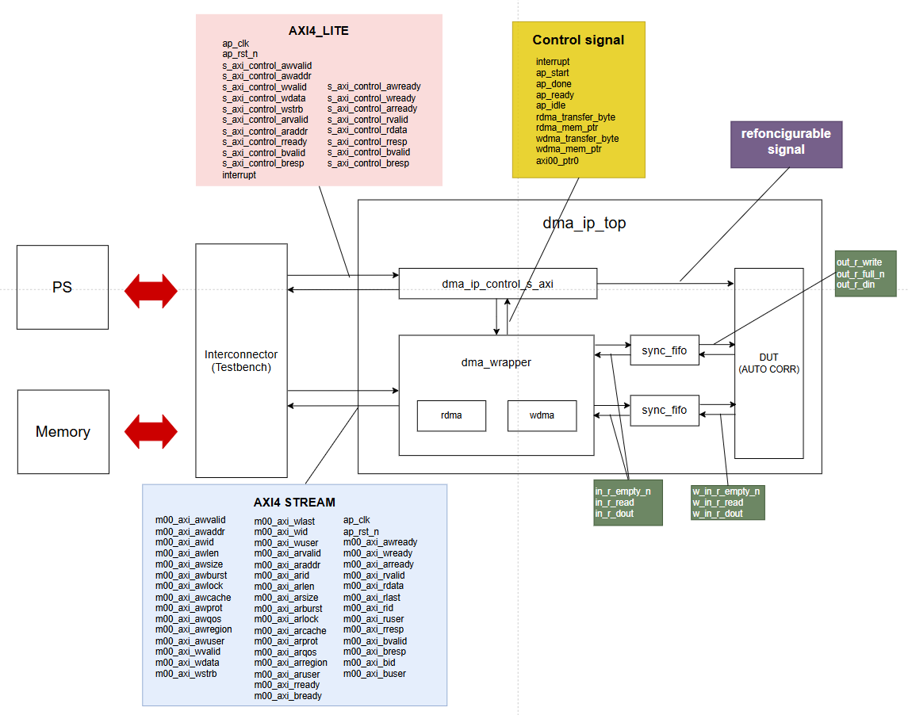
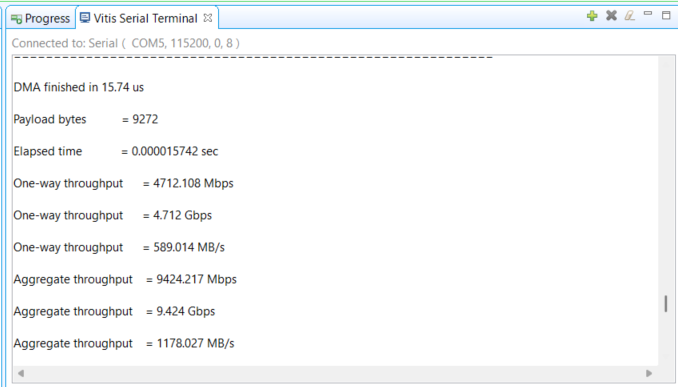
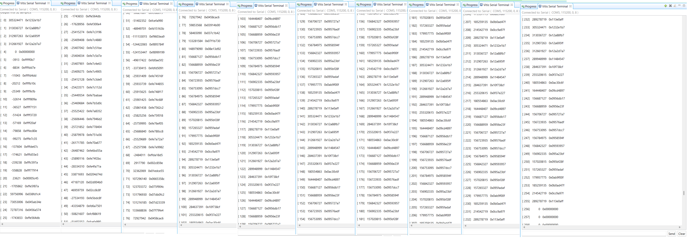
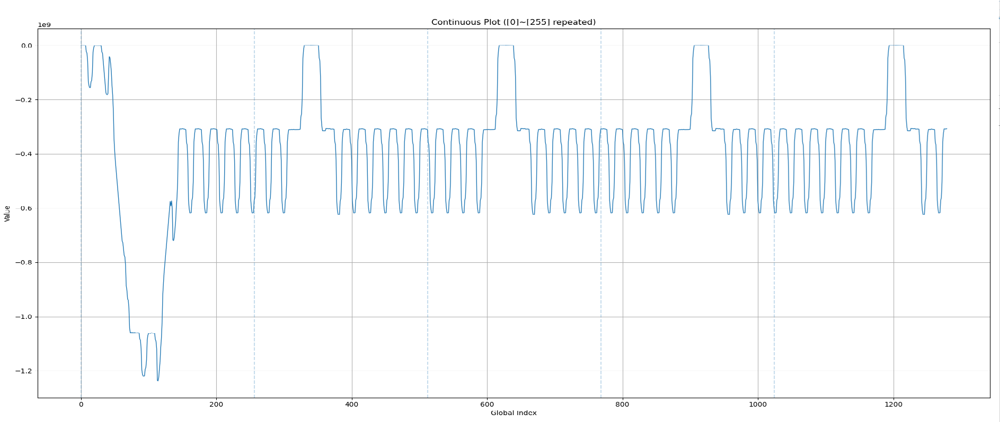

# OFDM Synchronizer (FPGA Real time processing validation)

---

## 1) DUT Architecture (dma_ip_top.v)

- AXI4 Stream
- AXI4 Lite

### submodules
`dma_ip_control_s_axis.v`
`dma_wrapper.v`
`sync_fifo.v`
`auto_corr.v`

---

## 2) FPGA Test Results (Refer to Video File- `FPGA_RESULT_VIDEO.mp4`)
### 1. Throughput Test on FPGA (RDMA -> Vandebeek auto corr -> WDMA)
- 1 OFDM Symbol (I/Q) consumes 32 bits (4 bytes) in DMA
- Approximately, 4.712 Gbps/4 = `1.18Gbps` is regarded as RX throughtput, only when Strobe signal is turned on always. 
- In reality, AXI handsake has some additional latency and delay, which leads to the loss of throughput.  

### 2. Acceleration Result from FPGA (Read data from DDR memory)
- Accelerlated result 0~255 sequences

### 3. Visualization of Accelerated Result
- The result data from FPGA does match with the result from RTL Vivado Simulation!!

