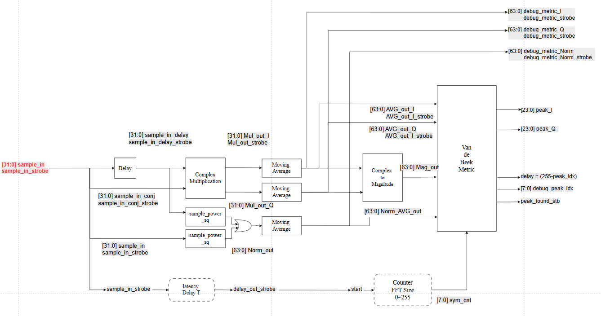
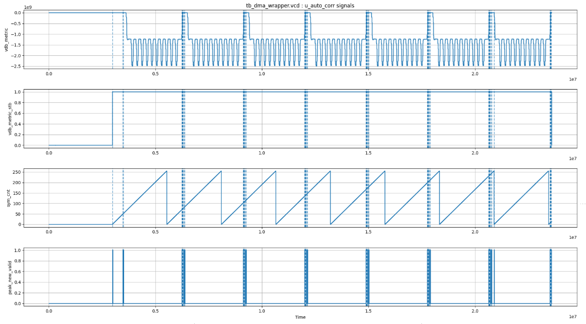

# `auto_corr` RTL Module Documentation


##  VandeBeek CP Auto correlation (auto_corr.v)

### submodules
`delayT.v`
`complex_mult.v`
`moving_avg_optimized.v`
`complex_to_mag.v`
`sample_power_sq.v`

---


## Simulation Results
### Input test case: 7 blocks(OFDM Symbol + CP)
- First graph: The result of CP Auto correlation (Van de Beek)
- Second graph: vdb_metric_stb (Instead of using axi ready valid handshake, strobe interface is used and there is no empty space)
- Third graph: Counter (`0~255`)
- 4th graph: Index valid signal when Maximum value is found within count period



## 1. Overview

The `auto_corr` module implements an FPGA-friendly OFDM timing synchronization metric based on delayed autocorrelation.

It computes the correlation between a delayed input sample and the conjugate of the current sample:

```text
C[n] = sum( x[n-D] * conj(x[n]) )
```

It also computes a normalization power term:

```text
P[n] = sum( |x[n-D]|^2 + |x[n]|^2 )
```

Then it generates a Van de Beek-style timing metric:

```text
S[n] = 2*|C[n]| - P[n]
```

This avoids division and is suitable for FPGA implementation.

---

## 2. Main Parameters

| Parameter | Description |
|---|---|
| `WINDOW_SHIFT` | Moving-average window size as log2. Default `5`, so window length is `32`. |
| `DELAY_SHIFT` | Delay length as log2. Default `8`, so delay is `256` samples. |
| `FFT_SIZE` | Peak-search window size. Default `256`. |
| `CNT_WIDTH` | Counter width for indexing within the FFT window. |
| `PEAK_WIDTH` | Output width for reduced peak I/Q values. |
| `IQ_WIDTH` | Bit width of each I/Q component. Default `16`. |
| `SHIFT_BITS` | Right-shift value used to reduce 64-bit correlation results. |

---

## 3. Input and Output Interface

### Input Sample

```verilog
input wire [31:0] sample_in;
input wire        sample_in_strobe;
```

The input sample format is:

```text
sample_in[31:16] = I
sample_in[15:0]  = Q
```

### Main Output

```verilog
output wire start_index;
```

`start_index` is intended to pulse when the synchronization peak is detected.

However, in the current RTL, the peak-search block is commented out. Therefore, `start_index` is not actively generated.

### Debug Outputs

| Signal | Description |
|---|---|
| `debug_metric_I` | Real part of averaged autocorrelation. |
| `debug_metric_Q` | Imaginary part of averaged autocorrelation. |
| `debug_metric_Norm` | Averaged normalization power. |
| `debug_metric_absC` | Magnitude of autocorrelation. |
| `debug_vdb_metric` | Van de Beek metric `S[n] = 2*|C[n]| - P[n]`. |
| `debug_vdb_metric_stb` | Valid strobe for `debug_vdb_metric`. |
| `peak_I`, `peak_Q` | I/Q value at detected peak. Currently inactive because peak search is disabled. |
| `debug_peak_idx` | Peak index inside FFT window. Currently inactive. |
| `peak_found_stb` | Peak-detection pulse. Currently inactive. |

---

## 4. Internal Processing Flow

The active processing pipeline is:

1. Delay the input sample by `2^DELAY_SHIFT` samples.
2. Generate the conjugate of the current input sample.
3. Multiply delayed sample with conjugated current sample.
4. Compute current and delayed sample power.
5. Align the power path with the delayed sample path.
6. Apply moving average to correlation I, correlation Q, and power.
7. Compute correlation magnitude `|C[n]|`.
8. Align normalization power with the magnitude path.
9. Compute Van de Beek metric:

```text
S[n] = 2*|C[n]| - P[n]
```

The intended but currently disabled stage is:

10. Search for the maximum metric over one FFT-sized window.

---

## 5. Delay and Correlation

The delay line generates:

```text
x[n-D]
```

where:

```text
D = 2^DELAY_SHIFT
```

The conjugate path generates:

```text
conj(x[n]) = I[n] - jQ[n]
```

The complex multiplier computes:

```text
x[n-D] * conj(x[n])
```

This is the core autocorrelation operation used for timing synchronization.

---

## 6. Power and Normalization

The module computes two power values:

```text
pwr_cur = |x[n]|^2
pwr_dly = |x[n-D]|^2
```

Then it sums them:

```text
pwr_sum = |x[n-D]|^2 + |x[n]|^2
```

This power term is accumulated by the moving-average block and used as the normalization reference in the Van de Beek metric.

---

## 7. Moving Average

The module uses three moving-average blocks:

| Block | Input | Output Meaning |
|---|---|---|
| `moving_avg_i_inst` | Correlation real part | Averaged `C_I[n]` |
| `moving_avg_q_inst` | Correlation imaginary part | Averaged `C_Q[n]` |
| `moving_avg_n_inst` | Power sum | Averaged `P[n]` |

The averaging length is:

```text
L = 2^WINDOW_SHIFT
```

With the default setting:

```text
L = 32
```

---

## 8. Van de Beek Metric

The RTL computes:

```verilog
vdb_metric <= $signed({1'b0, mag_out, 1'b0}) 
            - $signed({1'b0, metric_norm_aligned});
```

This corresponds to:

```text
S[n] = 2*|C[n]| - P[n]
```

The metric becomes large when the delayed autocorrelation is strong compared to the signal power.

This metric is useful because it avoids division, unlike normalized metrics such as:

```text
M[n] = |C[n]|^2 / P[n]^2
```

---

## 9. Current RTL Issues

### 9.1 Peak Search Is Disabled

The peak-search `always` block is currently commented out.

Therefore, the following outputs are not actively generated:

```text
start_index
peak_found_stb
peak_I
peak_Q
debug_peak_idx
```

To use the module as a complete synchronizer, the peak-search logic must be restored.

---

### 9.2 Undeclared Debug Signals

The RTL contains:

```verilog
assign debug_metric_S        = vdb_metric[31:0];
assign debug_metric_S_strobe = vdb_metric_stb;
```

However, these signals are not declared in the module port list.

Recommended fix:

```verilog
// Remove these assignments, or add the signals to the port list.
```

Since `debug_vdb_metric` and `debug_vdb_metric_stb` already exist, these extra signals are probably unnecessary.

---

### 9.3 Width Mismatch in Debug Correlation Outputs

`AVG_out_I` and `AVG_out_Q` are 64-bit signals, but they are assigned to 32-bit outputs:

```verilog
assign debug_metric_I = AVG_out_I;
assign debug_metric_Q = AVG_out_Q;
```

This causes truncation.

Recommended fix:

```verilog
assign debug_metric_I = $signed(AVG_out_I) >>> SCALE_BITS;
assign debug_metric_Q = $signed(AVG_out_Q) >>> SCALE_BITS;
```

where `SCALE_BITS` should be selected based on the expected signal range.

---

### 9.4 Threshold Registers Are Incomplete

The RTL declares:

```verilog
reg        threshold_enable;
reg [64:0] mag_sq_threshold;
```

but the active register-write logic is not implemented.

Also, the current metric is `vdb_metric`, which is signed 34-bit. Therefore, a signed threshold with the same width is cleaner:

```verilog
reg signed [33:0] vdb_threshold;
```

---

## 10. Recommended Fixes

Recommended next steps:

1. Remove or declare `debug_metric_S` and `debug_metric_S_strobe`.
2. Explicitly scale `AVG_out_I` and `AVG_out_Q` before assigning them to 32-bit debug outputs.
3. Decide whether `debug_metric_absC` should be 32-bit or 65-bit.
4. Replace `mag_sq_threshold` with a signed `vdb_threshold`.
5. Restore the peak-search block.
6. Verify pipeline latency between:

```text
sample_in_strobe
Mul_out_strobe
moving average outputs
mag_out_stb
vdb_metric_stb
peak_found_stb
```

---

## 11. Functional Summary

The current active RTL correctly implements the main metric-generation path:

```text
x[n-D] * conj(x[n])
C[n] = moving_average(correlation)
P[n] = moving_average(power)
S[n] = 2*|C[n]| - P[n]
```

However, it is not yet a complete synchronizer because the peak-detection logic is disabled.

After restoring the peak-search block and fixing the width/register issues, this module can be used as a practical FPGA-friendly OFDM timing synchronization block.
