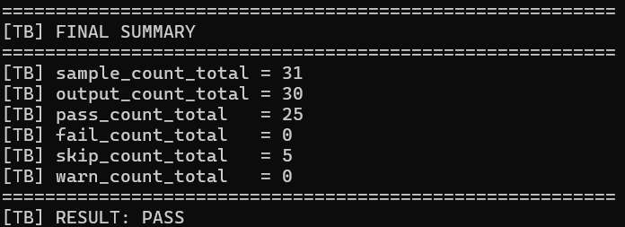

# CORDIC Arctan Wrapper and Testbench Summary

## 1. Overview

This document summarizes the **design intent of the DUT** (`cordic_arctan_strobe_wrapper_full`) and the **important test scenarios implemented in the testbench** (`tb_cordic_arctan_wrapper`).

The DUT is a wrapper around a Xilinx CORDIC IP core and is responsible for:

- converting wide signed input samples into the format expected by the CORDIC,
- aligning data and valid timing correctly,
- handling normalization and saturation,
- capturing the CORDIC phase output as a signed fixed-point value.

The testbench verifies not only numerical phase correctness, but also protocol behavior such as:

- valid/data alignment,
- back-to-back input streaming,
- enable masking,
- reset recovery,
- corner-case handling.

---

## 2. DUT Summary

### 2.1 DUT Name
- `cordic_arctan_strobe_wrapper_full`

### 2.2 Main Purpose
The DUT receives wide signed I/Q values (`avg_out_i`, `avg_out_q`) together with an input strobe (`avg_out_strobe`) and computes the phase using a Xilinx CORDIC IP.

### 2.3 Important Internal Functions

#### (1) Absolute-value handling with saturation
The DUT computes absolute values of `avg_out_i` and `avg_out_q` using a safe absolute-value function that also handles the **most-negative two's complement input**.

This prevents overflow in cases such as:
- `x = 1000...0` (most negative signed value)

#### (2) Common normalization shift
The DUT computes:

- `abs_i = |avg_out_i|`
- `abs_q = |avg_out_q|`
- `max_mag = max(abs_i, abs_q)`

Then it finds the MSB position of `max_mag` and applies a **common arithmetic right shift** to both I and Q so that the vector magnitude fits the target CORDIC input range with headroom.

This is important because:

- phase depends on the **ratio** of Q/I,
- common scaling preserves that ratio,
- overflow at the CORDIC input is avoided.

#### (3) Arithmetic right shift with optional rounding
The DUT uses arithmetic right shift with symmetric rounding.

If rounding is enabled:
- positive values use bias `2^(sh-1)`
- negative values use bias `2^(sh-1)-1`

This improves accuracy compared with simple truncation.

#### (4) Saturation to CORDIC width
After normalization, the shifted values are saturated to the signed CORDIC input width (`CORDIC_W = 24`).

#### (5) Valid/data alignment
The normalized I/Q values are registered for one cycle, and the strobe is also delayed by one cycle.

This ensures that:
- `s_axis_cartesian_tdata`
- `s_axis_cartesian_tvalid`

reach the Xilinx CORDIC IP in perfect alignment.

#### (6) Xilinx CORDIC input packing
The DUT sends the CORDIC input as:

```verilog
{q_sf_r, i_sf_r}
```

That is:
- upper bits: `Y = Q`
- lower bits: `X = I`

This matches the Xilinx cartesian input convention used in the design.

#### (7) Signed output cast
The CORDIC output port is a plain 24-bit wire, so the DUT explicitly casts it to signed:

```verilog
phase_cordic <= $signed(m_axis_dout_tdata);
```

This is essential for correct negative phase interpretation.

---

## 3. Important DUT Behavior Verified by the Testbench

The testbench verifies the following DUT properties:

1. **Correct phase computation** for normal I/Q inputs
2. **Correct data/valid alignment**
3. **Stable fixed latency**
4. **Correct behavior under back-to-back streaming**
5. **Correct suppression when enable is low**
6. **Correct recovery after reset**
7. **Reasonable handling of extreme corner cases**

---

## 4. Testbench Summary

### 4.1 Testbench Name
- `tb_cordic_arctan_wrapper`

### 4.2 Testbench Architecture

The testbench uses:

- a **race-free scoreboard**
- an **expected FIFO**
- a **cycle stamp FIFO**
- a **skip policy** for special cases
- a **reset-settle ignore window**

The scoreboard owns all FIFO pointers and counts, so there is no race between tasks and the scoreboard logic.

### 4.3 Expected Phase Model

The expected phase is generated using a reference function that matches the observed Xilinx CORDIC output encoding:

\[
\text{phase\_code} \approx \theta[\text{rad}] \cdot \frac{2^{W-1}}{4}
\]

where:
- `W = CORDIC_W = 24`
- `theta` is the phase angle in radians

A special branch policy is used for:
- `(-X, 0)` → mapped to `-π`

This was needed to match the actual DUT / Xilinx branch-cut behavior.

### 4.4 Compare Policy

The testbench compares:
- DUT output phase
- expected phase code

using a **wrap-aware phase error** function, because phase codes are circular quantities.

Tolerance:
- `TOL_LSB = 512`

### 4.5 Skip Policy

Some vectors are intentionally skipped instead of being marked as failures.

#### Skipped cases:
- `(0, 0)` input
- ultra-small vectors where `max(|x|, |y|) <= TINY_THRESH`

Reason:
- phase is undefined or numerically unstable for very small vectors,
- tiny fixed-point vectors are strongly affected by quantization and CORDIC implementation details.

This skip policy prevents false failures in mathematically ambiguous cases.

---

## 5. Important Test Scenarios

## 5.1 TEST 1: Smoke / Axes / Quadrants

This test verifies basic correctness in the most important geometric directions.

### Included vectors
- `(+X, 0)`
- `(0, +Y)`
- `(-X, 0)`
- `(0, -Y)`
- Quadrant I
- Quadrant II
- Quadrant III
- Quadrant IV

### Why it matters
This confirms:
- sign handling,
- quadrant selection,
- X/Y input packing correctness,
- correct branch handling on axes.

---

## 5.2 TEST 2: Zero / Tiny / Near-Axis

This test checks behavior around numerically sensitive regions.

### Included vectors
- `(0, 0)`
- `(1, 0)`
- `(0, 1)`
- `(large, 1)`
- `(1, large)`
- `(-large, 1)`
- `(1, -large)`

### Why it matters
This confirms:
- near-axis behavior,
- tiny-vector handling,
- skip policy correctness,
- stability around low-magnitude inputs.

---

## 5.3 TEST 3: Scale Invariance

This test uses vectors with the same direction but different magnitudes.

### Example pattern
- `(100, 200)`
- `(1000, 2000)`
- `(10000, 20000)`
- `(1000000, 2000000)`

### Why it matters
Because the DUT uses **common normalization scaling**, phase should remain almost unchanged as long as the direction is the same.

This test validates:
- common-shift normalization,
- preservation of I/Q ratio,
- robustness across magnitude ranges.

---

## 5.4 TEST 4: Back-to-Back Stream

This test drives valid samples in consecutive cycles with no bubbles.

### Why it matters
This validates:
- throughput behavior,
- no loss of alignment under continuous streaming,
- correct scoreboard matching under dense traffic,
- proper handling of the internal CORDIC pipeline in stream mode.

This is especially important because the DUT is not only a mathematical block but also a **stream wrapper** around an IP pipeline.

---

## 5.5 TEST 5: Enable Masking

This test toggles `enable` low and high during operation.

### Behavior under test
- while `enable = 0`, inputs are applied but should not be treated as valid DUT transactions,
- after `enable = 1`, normal operation should resume cleanly.

### Why it matters
This confirms:
- valid suppression policy,
- no unintended output checking during disabled periods,
- clean restart after re-enabling.

---

## 5.6 TEST 6: Mid-Run Reset

This test asserts reset in the middle of activity.

### Additional testbench support
After reset deassertion, the scoreboard ignores `phase_strobe` for a configurable number of cycles:

- `RESET_IGNORE_CYC = 40`

### Why it matters
This confirms:
- DUT pipeline reset recovery,
- scoreboard reset recovery,
- clean restart without false mismatches caused by pipeline settling.

---

## 5.7 TEST 7: File-Driven Regression

The testbench can optionally read vectors from:

- `cordic_tc_24b.hex`

### File format
Each line contains:
- `X24hex`
- `Y24hex`
- `PHASE24hex`

### Why it matters
This allows:
- large regression testing,
- externally generated reference vectors,
- reuse of vectors from C or Python models.

If the file is missing, the testbench skips this scenario without failing.

---

## 6. Observed Final Test Result

From the final simulation log:

- `sample_count_total = 31`
- `output_count_total = 30`
- `pass_count_total   = 25`
- `fail_count_total   = 0`
- `skip_count_total   = 5`
- `warn_count_total   = 0`

Final result:
- **PASS**

### Interpretation
This means:

- all compared vectors passed,
- no true verification failures remained,
- skipped cases were only the intentionally excluded corner cases,
- no scoreboard warnings or FIFO issues occurred.

---

## 7. Most Important Verification Conclusions

### DUT correctness
The DUT is verified to correctly:
- normalize wide I/Q inputs,
- align valid and data timing,
- feed the Xilinx CORDIC correctly,
- capture signed phase output correctly.

### Protocol correctness
The DUT and wrapper behavior are verified under:
- sparse input traffic,
- continuous streaming traffic,
- enable masking,
- mid-run reset.

### Corner-case policy
The testbench intentionally skips:
- undefined zero-vector phase,
- ultra-small vectors dominated by quantization effects.

This makes the regression more realistic and avoids false failures.

---

## 8. Recommended Future Extensions

Possible next improvements:

1. add a large random file-driven regression set,
2. tighten `TOL_LSB` if required,
3. add a strict latency assertion (for example, always require latency = 30),
4. classify skipped vectors into separate reporting groups,
5. add more boundary tests around saturation and sign transitions.

---

## 9. Final Summary

The DUT and testbench together now provide a solid verification framework for the Xilinx CORDIC arctangent wrapper.

The most important validated points are:

- correct phase generation,
- correct fixed-point encoding interpretation,
- correct wrapper timing,
- correct operation under streaming, enable, and reset scenarios,
- stable and realistic treatment of corner cases.

This makes the environment suitable for:
- regression testing,
- integration verification,
- future expansion with externally generated vector files.
