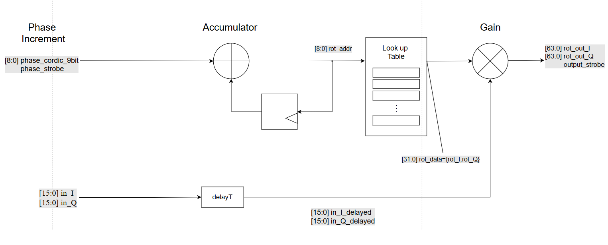

# Rotate Block Design Notes

---

## 1) Rotate Block Overview



The rotate block performs carrier phase compensation using a LUT-based phase rotator and a fixed-point complex multiplier.

### Datapath
```
phase increment → phase accumulator → LUT → complex gain → rotated output
```

---

## 2) Current Implementation

The current design uses a **512-entry LUT covering the full range \(0 \sim 2\pi\)**.

### Phase Resolution

\[
\Delta \phi = rac{2\pi}{512} pprox 0.01227 	ext{ rad} pprox 0.703^\circ
\]

This relatively coarse resolution introduces phase quantization error.

---

## 3) Fixed-Point Model

The current C model reflects RTL behavior:

```c
phase_acc += (phase_increment << 8);
addr = (phase_acc >> 23) & 0x1FF;
```

This includes internal scaling, but final resolution is still limited by the 512-entry LUT.

---

## 4) Limitation

Main performance degradation sources:

- Phase quantization (512 steps over 2π)
- LUT coefficient quantization
- Phase increment rounding
- Fixed-point arithmetic errors

---

## 5) Proposed Improvement: Folded LUT

Instead of mapping the LUT over full \(2\pi\), use symmetry:

- Store only a reduced range:
  - \(0 \sim rac{\pi}{2}\) (quarter-wave)
  - or \(0 \sim rac{\pi}{4}\) (eighth-wave)
- Reconstruct full phase using:
  - sign inversion
  - I/Q swapping
  - quadrant logic

---

## 6) Benefit

With the same 512 entries:

### Full LUT
\[
rac{2\pi}{512}
\]

### Quarter-wave LUT
\[
rac{\pi/2}{512}
\]

→ **4× finer resolution**

### Eighth-wave LUT
\[
rac{\pi/4}{512}
\]

→ **8× finer resolution**

---

## 7) Updated Architecture

### Current
```
phase → full LUT (0~2π) → rotation
```

### Proposed
```
phase → folded LUT (small range) → symmetry reconstruction → rotation
```

---

## 8) Design Direction

### Keep
- Phase accumulator
- Fixed-point multiplier
- Pipeline alignment

### Modify
- Replace full LUT with folded LUT
- Add quadrant/sign reconstruction logic

---

## 9) Conclusion

- Current design suffers from coarse phase quantization.
- Folding improves effective resolution without increasing LUT size.
- Recommended to adopt folded LUT structure for the rotate block.

---

## One-line Summary

> Use folded LUT instead of full 2π LUT to significantly improve phase resolution and reduce quantization error.
